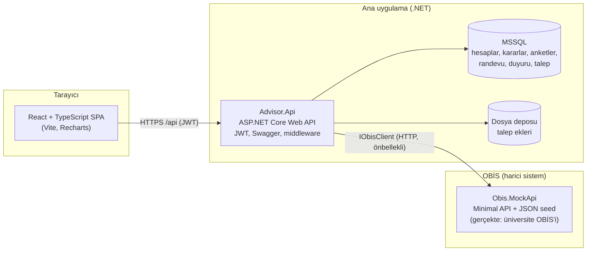
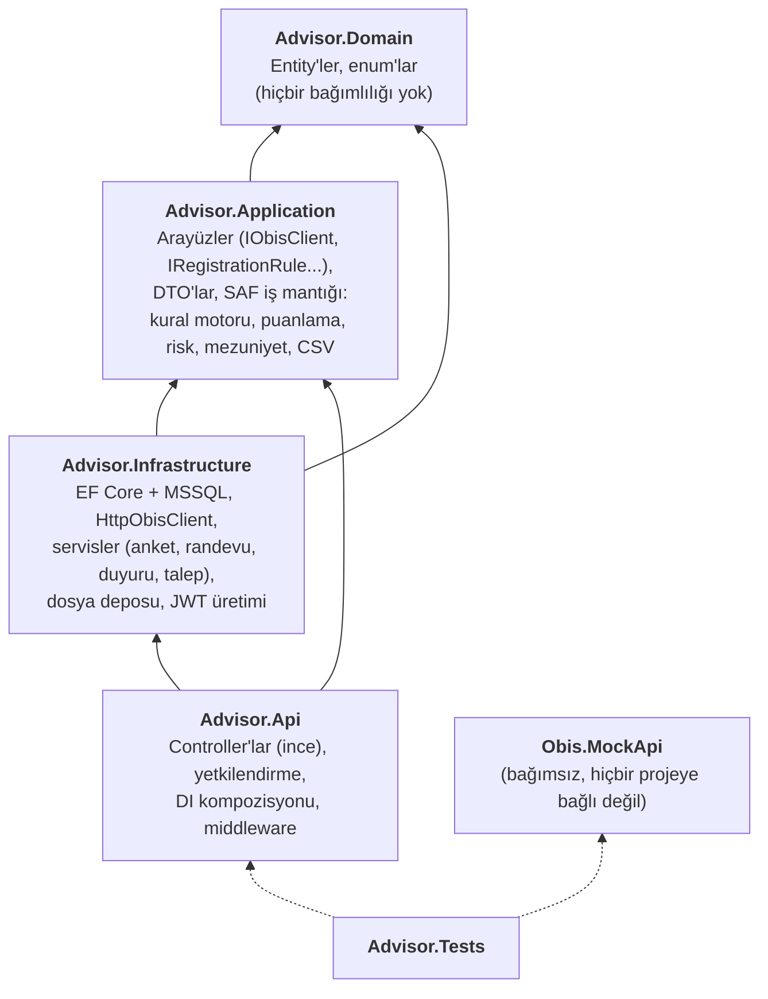
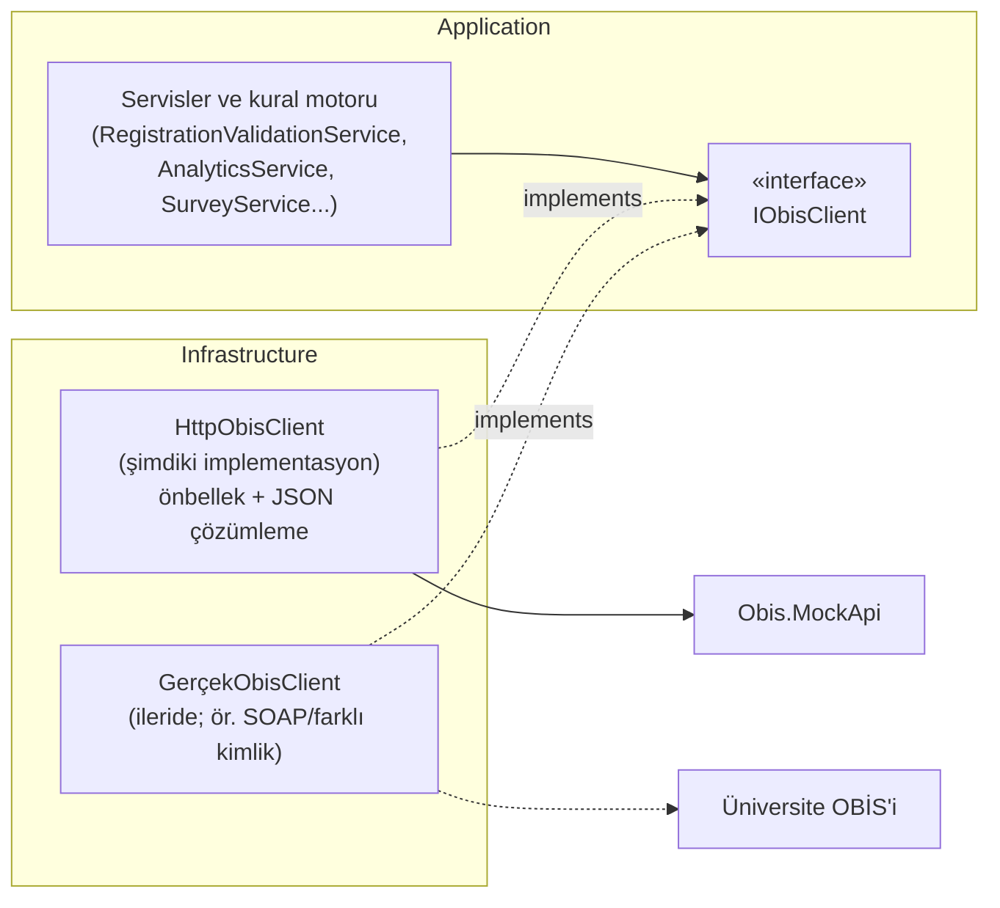
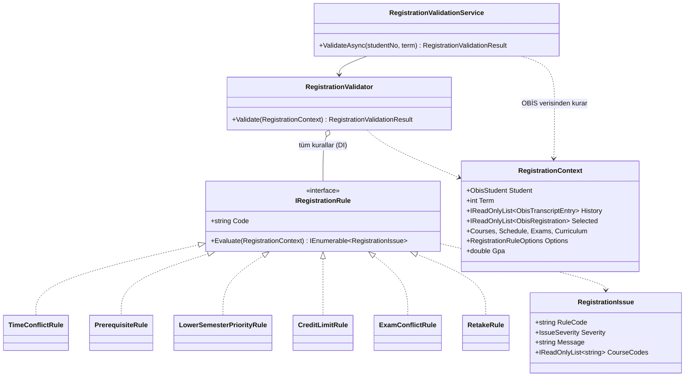
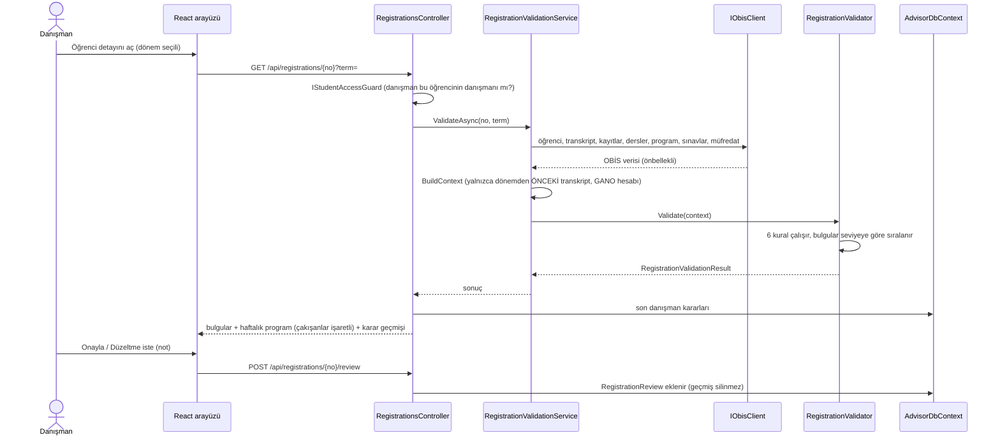
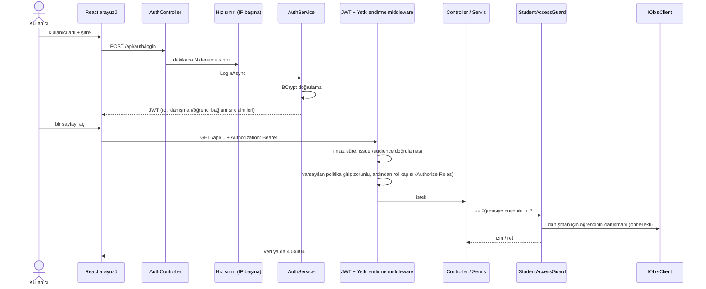
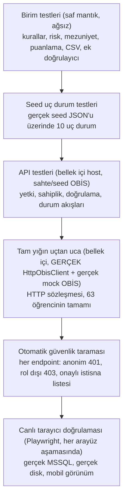
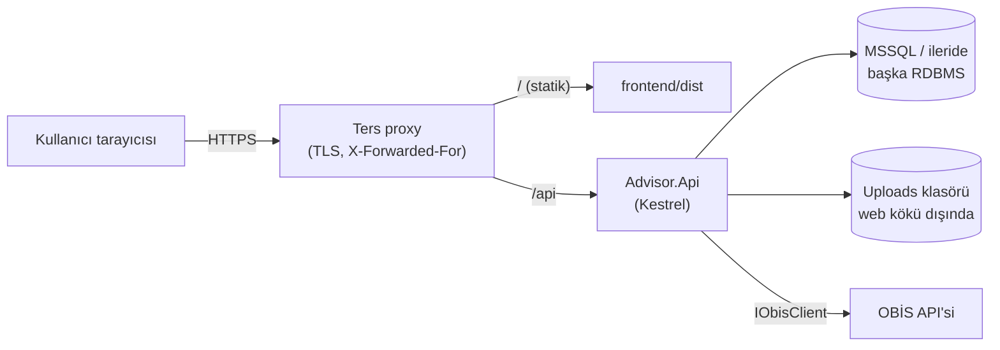

# Mimari

Bu belge sistemin katmanlarını, bileşenler arası veri akışını, ana tasarım kararlarını ve gerekçelerini açıklar. Bitirme
raporunun teknik bölümü için temel olacak şekilde yazılmıştır. Karar ayrıntıları için [DECISIONS.md](DECISIONS.md), aşama aşama
ilerleme için [PROGRESS.md](PROGRESS.md) dosyalarına bakın.

## İçindekiler

1. [Genel bakış](#genel-bakış)
2. [Katmanlar ve bağımlılık yönü](#katmanlar-ve-bağımlılık-yönü)
3. [Adapter deseni ve OBİS entegrasyonu](#adapter-deseni-ve-obis-entegrasyonu)
4. [Kural motoru (ders kaydı doğrulama)](#kural-motoru-ders-kaydı-doğrulama)
5. [Kimlik doğrulama ve yetkilendirme](#kimlik-doğrulama-ve-yetkilendirme)
6. [Veri modeli](#veri-modeli)
7. [Modüller ve veri akışı](#modüller-ve-veri-akışı)
8. [Frontend mimarisi](#frontend-mimarisi)
9. [Güvenlik modeli](#güvenlik-modeli)
10. [Test stratejisi](#test-stratejisi)
11. [Dağıtım](#dağıtım)
12. [Gerçek OBİS'e geçiş](#gerçek-obise-geçiş)
13. [Tasarım gerekçelerinin özeti](#tasarım-gerekçelerinin-özeti)

## Genel bakış

Sistem üç ayrı süreçten oluşur. Ana uygulama (backend API + React arayüzü) öğrenci verisini **kendi veritabanında tutmaz**; OBİS'ten
okur. Ana veritabanında yalnızca ana uygulamaya özgü kayıtlar bulunur: hesaplar, danışman kararları, anketler, randevular, duyurular,
talepler.

İlke: **OBİS verisi kopyalanmaz.** Öğrenci, transkript, ders programı, sınav takvimi, devamsızlık, staj bilgisi her istekte OBİS'ten
(30 sn önbellekle) okunur. Böylece iki yerde tutulan veri arasında tutarsızlık oluşmaz ve gerçek OBİS'e geçiş yalnızca bir adaptörün
değişmesidir.

## Katmanlar ve bağımlılık yönü

| Katman | Sorumluluk | Neden böyle |
| --- | --- | --- |
| **Domain** | Entity'ler ve enum'lar | Dış bağımlılığı olmayan çekirdek; EF Core bile burada yok. |
| **Application** | Arayüzler, DTO'lar ve **saf** iş mantığı | Kural motoru, puanlama, risk ve mezuniyet hesabı veri çekmez, yalnızca bağlamı okur → ağsız, hızlı ve küçük verilerle birim testlenebilir. |
| **Infrastructure** | Dış dünya: veritabanı, HTTP, dosya sistemi; orkestrasyon servisleri | Dış sistemlere dokunan her şey burada; Application bunlara yalnızca arayüzle bağlıdır. |
| **Api** | HTTP yüzeyi | Controller'lar ince: rol kapısı + servis çağrısı. Sahiplik/iş kuralları servis katmanındadır, böylece HTTP olmadan da test edilir ve her giriş noktasında aynı uygulanır. |
| **Obis.MockApi** | Gerçek OBİS'in taklidi | Ana uygulamaya **proje referansı yoktur**; yalnızca HTTP üzerinden konuşulur. Gerçek OBİS'e geçişte bu proje atılır. |

Bağımlılık yönü içe doğrudur: iç katman dış katmanı bilmez. `IObisClient`, `IFileStore` gibi arayüzler Application'dadır;
implementasyonları Infrastructure'dadır (bağımlılığın tersine çevrilmesi).

## Adapter deseni ve OBİS entegrasyonu

* Tüm OBİS verisi tek arayüzden geçer: öğrenciler, transkript, kayıtlar, devamsızlık, dersler, program, sınavlar, müfredat, staj, danışmanlar.
* `Advisor.Application` içindeki OBİS DTO'ları, mock'un kendi modellerinden **kasıtlı olarak farklı tiplerdir** (`ObisStudent` vs
  `StudentInfo`). Mock'a hiç referans yoktur; sözleşme yalnızca JSON'dur. Bu, gerçek OBİS'in alan adları farklı geldiğinde etkilenen
  tek yerin adaptör olmasını sağlar.
* `HttpObisClient` kısa süreli `IMemoryCache` kullanır (varsayılan 30 sn); aynı istekte onlarca çağrı olsa bile OBİS'e bir kez gidilir.
* OBİS erişilemezse `HttpRequestException` global exception middleware'inde **502** ve Türkçe mesaja çevrilir.
* JSON sözleşmesi (metin olarak gelen enum'lar, tarih/saat biçimleri) **gerçek mock'a karşı bellek içi uçtan uca testlerle** doğrulanır.

## Kural motoru (ders kaydı doğrulama)

Tasarım kararları:

* **Kurallar saftır.** `Evaluate(context)` dış dünyaya gitmez; bu yüzden her kural küçük, elle kurulmuş verilerle test edilir
  (sınır durumları: bitişik saat, farklı şube, aynı dönemde alınan önkoşul...).
* **Yeni kural = yeni sınıf.** `AddRegistrationRules` derlemeyi tarar ve `IRegistrationRule` uygulayan her sınıfı DI'a kaydeder; başka
  kayıt/yapılandırma gerekmez. Testler kural sayısını doğrular.
* **Dönem kesiti.** Bir dönem doğrulanırken yalnızca o dönemden **önceki** transkript kullanılır; aksi halde geçmiş dönemler
  incelenirken sonradan geçilen dersler önkoşul sayılırdı. GANO da bu kesitten, transkriptten hesaplanır (OBİS değerleriyle birebir uyumludur).
* **Eşikler yapılandırmadan gelir** (`RegistrationRules`): GANO bantları, AKTS sınırları, tekrar alma not eşiği.

Aynı yaklaşım diğer analizlerde de uygulanır: `RiskCalculator` (6 gösterge, her biri açıklamalı), `GraduationAnalyzer` (koşullar ve
projeksiyon), `SurveyScoring` (anket puanı), `Csv` (okuma/yazma + CSV enjeksiyon koruması) hep saf statik sınıflardır.

## Kimlik doğrulama ve yetkilendirme

Üç katmanlı yetki:

1. **Varsayılan-reddet.** `FallbackPolicy = RequireAuthenticatedUser`: `[AllowAnonymous]` ile açıkça işaretlenmeyen her endpoint giriş ister.
   Şu an anonim olan tek endpoint `POST /api/auth/login`'dir (test bunu otomatik doğrular).
2. **Rol kapısı.** `[Authorize(Roles = ...)]` ile Admin / Danisman / Ogrenci ayrımı.
3. **Sahiplik.** Rol yetmez: danışman **yalnızca kendi öğrencilerini**, öğrenci **yalnızca kendini** görür. Bu kural `IStudentAccessGuard`'da
   tek yerde tutulur; danışman-öğrenci eşlemesi JWT'ye gömülmez, her istekte OBİS'ten (önbellekli) doğrulanır, böylece danışman ataması
   değişirse eski token'la erişim sürmez. Anket ve duyuru gibi kaynaklarda sahip, kaydı oluşturan danışmandır.

| Rol | Yapabildikleri |
| --- | --- |
| **Admin** | Tüm öğrenciler ve tüm danışmanların anket/duyuruları (okuma, silme); görüşme saati ve not **yazamaz** |
| **Danisman** | Kendi öğrencileri: ders kaydı kararı, anket/duyuru oluşturma, risk, mezuniyet, randevu saatleri, notlar, talepler |
| **Ogrenci** | Yalnızca kendisi: ders kaydı, mezuniyet analizi, anket doldurma, randevu alma, gelen kutusu, talep açma. Risk puanını ve görüşme notlarını **göremez** |

## Veri modeli

Ana veritabanı yalnızca ana uygulamaya özgü kayıtları tutar. Öğrenci/danışman kimlikleri OBİS'e `StudentNo` / `AdvisorId` metin anahtarlarıyla
bağlanır (yabancı anahtar değil: o veri başka sistemdedir).

```mermaid
erDiagram
    AppUser {
        guid Id PK
        string Username UK
        string PasswordHash
        string Role "Admin|Danisman|Ogrenci"
        string LinkedAdvisorId "OBİS"
        string LinkedStudentNo "OBİS"
    }
    RegistrationReview {
        guid Id PK
        string StudentNo "OBİS"
        int Term
        string Decision "Approved|RevisionRequested"
        string Note
        string ReviewedByAdvisorId
    }
    Survey ||--o{ SurveyQuestion : "sorular"
    SurveyQuestion ||--o{ SurveyQuestionOption : "seçenekler"
    Survey ||--o{ SurveyResponse : "yanıtlar"
    SurveyResponse ||--o{ SurveyAnswer : "cevaplar"
    Survey {
        guid Id PK
        string CreatedByAdvisorId
        date StartDate
        date EndDate
        int TargetClassYear
    }
    SurveyQuestion {
        guid Id PK
        string Type "Single|Multi|Number|Text"
        double Weight
        bool Required
    }
    SurveyQuestionOption {
        guid Id PK
        double Score
    }
    SurveyResponse {
        guid Id PK
        string StudentNo "OBİS; (SurveyId,StudentNo) tekil"
        bool ConsentAccepted
        datetime ConsentAcceptedAt
        bool ImportedExternally
    }
    NeedScoreResult {
        guid Id PK
        guid SurveyId
        string StudentNo "(SurveyId,StudentNo) tekil"
        double TotalScore "atama anındaki puan"
        string SupportAssigned
    }
    AppointmentSlot ||--o{ Appointment : "rezervasyonlar"
    AppointmentSlot {
        guid Id PK
        string AdvisorId "OBİS"
        string DayOfWeek
        time StartTime
        time EndTime
        bool IsActive
    }
    Appointment {
        guid Id PK
        string StudentNo "OBİS"
        date Date "(SlotId,Date) kısmi tekil: yalnızca planlı"
        string Status
        string CancellationReason
    }
    MeetingNote {
        guid Id PK
        string AdvisorId
        string StudentNo "OBİS"
        string Content "öğrenciye kapalı"
    }
    Announcement ||--o{ AnnouncementRecipient : "alıcılar"
    Announcement {
        guid Id PK
        string AdvisorId
        string Title
        int FilterClassYear
        double FilterMinGpa
        double FilterMaxGpa
        string FilterRiskLevel
        bool FilterInternshipComplete
    }
    AnnouncementRecipient {
        guid Id PK
        string StudentNo "OBİS"
        datetime ReadAt "boşsa okunmadı"
    }
    PetitionRequest {
        guid Id PK
        string StudentNo "OBİS"
        string Type
        string Status "Beklemede|Inceleniyor|Onaylandi|Reddedildi"
        string AdvisorNote
        string AttachmentPath "rastgele saklama adı"
    }
    Notification {
        guid Id PK
        string StudentNo "OBİS"
        string Message
        datetime ReadAt
    }
```

Bilinçli tercihler: puan veritabanında **saklanmaz**, her seferinde cevaplardan canlı hesaplanır (ağırlıklar sonradan değişebildiği için);
yalnızca destek atama anındaki puan denetim izi olarak tutulur. Karar kayıtları (`RegistrationReview`) güncellenmez, her karar yeni satırdır.
Çifte rezervasyon ve çift anket gönderimi hem uygulama kontrolüyle hem veritabanı tekil indeksleriyle engellenir.

## Modüller ve veri akışı

| Modül | Giriş noktası (API) | Servis / mantık | OBİS'ten okunan | Ana veritabanında yazılan |
| --- | --- | --- | --- | --- |
| Ders kaydı doğrulama | `RegistrationsController` | `RegistrationValidationService` + 6 `IRegistrationRule` | öğrenci, transkript, kayıt, program, sınav, müfredat | `RegistrationReview` |
| Anket ve puanlama | `SurveysController` | `SurveyService`, `SurveyScoring`, `Csv` | öğrenci listesi (hedef kitle, ad) | Survey, Question, Option, Response, Answer, NeedScoreResult |
| Erken uyarı / mezuniyet / panel | `AnalyticsController` | `RiskCalculator`, `GraduationAnalyzer`, `AnalyticsService` | transkript, kayıt, devamsızlık, staj, müfredat | — (yalnızca okur) |
| Randevu | `AppointmentsController` | `AppointmentService` | öğrenci, danışman | AppointmentSlot, Appointment, Notification |
| Notlar / öğrenci dosyası | `StudentFileController` | `StudentFileService` | öğrenci, transkript | MeetingNote |
| Duyuru ve gelen kutusu | `AnnouncementsController`, `InboxController` | `AnnouncementService`, `InboxService` (hedefleme `AnalyticsService` profilinden) | öğrenci, risk için transkript/devamsızlık, staj | Announcement, AnnouncementRecipient |
| Talepler | `PetitionsController` | `PetitionService`, `AttachmentValidator`, `IFileStore` | öğrenci | PetitionRequest, Notification, dosya deposu |

Modüller arası etkileşimler: randevu iptali ve talep durumu değişikliği öğrenciye `Notification` üretir (gelen kutusunda görünür); duyuru
hedeflemesi risk seviyesini analiz modülünden alır; öğrenci dosyasının zaman çizelgesi randevu, talep ve duyuruları birleştirir.

## Frontend mimarisi

* **React 19 + TypeScript + Vite**, yönlendirme `react-router-dom`; **saf CSS** (tasarım değişkenleri, koyu tema `prefers-color-scheme`).
  Tek ek çalışma zamanı bağımlılığı grafikler için `recharts`'tır ve tembel yüklenir (yalnızca danışman paneli indirir).
* **`api/client.ts`:** tek `fetch` sarmalayıcısı; JWT'yi ekler, sunucunun Türkçe `message` alanını gösterir, durum koduna göre yedek mesajlar
  üretir, 401'de otomatik çıkış yapar. Dosya indirme (`download`) ve `FormData` (`postForm`) desteği vardır.
* **`useAsync`:** yükleniyor / hata / hazır durumlarını yönetir; yenilemede (retry) mevcut veriyi ekranda tutar, girdiler değişince yükleniyor gösterir.
* **Rol bazlı menü ve rota koruması:** `RequireAuth` rolü kontrol eder. Bu **güvenlik sınırı değildir** (yalnızca kullanıcıya gereksiz sayfa göstermez);
  gerçek yetki backend'dedir.
* Her ekranda yükleniyor / boş / hata durumları ortak bileşenlerle (`Feedback`) gösterilir; sayfalar 390 px genişlikte yatay taşma olmadan çalışır.

## Güvenlik modeli

| Tehdit | Önlem |
| --- | --- |
| Yetkisiz erişim | Varsayılan-reddet politikası, rol kapısı, sahiplik guard'ı; **tüm endpoint'ler otomatik taranarak** test edilir |
| Başka öğrencinin verisini okuma | `IStudentAccessGuard` + servislerde sahiplik kontrolü (başkasının kaynağı için 403/404) |
| Kaba kuvvet giriş denemesi | IP başına dakikada 10 deneme (429), BCrypt parola özeti |
| Token sahteciliği | İmza/süre/issuer/audience doğrulaması; üretimde zayıf ya da geliştirme anahtarıyla **uygulama başlamaz** |
| Bilinen demo şifreleri | Demo hesaplar üretimde oluşmaz (açıkça istenmedikçe) |
| Zararlı dosya yükleme | Uzantı izin listesi, **dosya imzası doğrulaması**, 5 MB sınırı, rastgele saklama adı (yol gezintisi yok), `attachment` + `nosniff` ile indirme |
| CSV/Excel formül enjeksiyonu | Dışa aktarılan hücrelerde `= + - @` ile başlayan metinlere kesme işareti eklenir (sayılar hariç) |
| Çifte işlem / yarış koşulu | Kısmi tekil indeks (randevu), tekil indeks (anket yanıtı, duyuru alıcısı) |
| Kişisel veri (KVKK) | Anket için açık rıza zorunlu; yanıtlara yalnızca sahip danışman ve yönetici erişir; istatistik kimliksizdir; öğrenciye puan ve ağırlık hiç gönderilmez |
| Bilgi sızıntısı | Global exception middleware iç hata ayrıntısını istemciye vermez; yalnızca Türkçe, genel mesaj |
| Tarayıcı tabanlı saldırılar | `nosniff`, `X-Frame-Options: DENY`, `Referrer-Policy`, üretimde HSTS; CORS kapalı (aynı origin) |

## Test stratejisi

* **333 backend testi**, `dotnet test` ile saniyeler içinde çalışır; ağ portu gerektirmez (host bellek içidir).
* Her testin kendi durumu vardır (gerekli yerlerde test başına ayrı host/veritabanı): testler arası sızıntı olmaz.
* Saat `TimeProvider` ile enjekte edilir; randevu ve anket tarih mantığı sabit saatle deterministik test edilir.
* Seed üretimi deterministiktir; testler iki kez üretilen çıktının birebir aynı olduğunu varsayar (bu da doğrulanmıştır).

## Dağıtım

Geliştirmede ön yüz ve API aynı origin'den görünsün diye Vite proxy `/api`'yi backend'e yönlendirir; üretimde aynı rolü ters proxy oynar.
Ayrıntılı üretim notları için [README → Üretime alma notları](../README.md#üretime-alma-notları).

## Gerçek OBİS'e geçiş

Mock OBİS yalnızca geliştirme ve gösterim içindir. Gerçek OBİS'e geçerken **değişmesi gerekenler** ve **değişmemesi gerekenler**:

**Değişir**

1. **`IObisClient` için yeni implementasyon** (`Advisor.Infrastructure/Obis/`): gerçek OBİS'in protokolü (REST/SOAP), kimlik doğrulaması
   (API anahtarı, OAuth, mTLS) ve alan adları buraya eşlenir. Application'daki `Obis*` DTO'ları sözleşmedir; gerçek alanlar bunlara dönüştürülür.
2. **DI kaydı** (`DependencyInjection.AddInfrastructure`): `AddHttpClient<IObisClient, HttpObisClient>` yerine yeni istemci.
3. **Yapılandırma:** `Obis:BaseUrl`, kimlik bilgileri (gizli bilgi olarak, repoda değil), `Obis:CacheSeconds` (gerçek sistemin yük limitine göre).
4. **Kimlik bağlantısı:** `AppUser.LinkedStudentNo` / `LinkedAdvisorId` gerçek OBİS numaralarıyla eşleşmeli; mümkünse hesaplar elle değil
   kurumsal kimlik sağlayıcıdan (SSO/LDAP) gelmeli (şu an uygulamanın kendi kullanıcı tablosu vardır).
5. **Veri sözleşmesi doğrulaması:** gerçek OBİS'ten `ObisAttendance`, staj günü ve ders şube/saat verisinin hangi uç noktadan nasıl geldiği
   netleştirilmeli. Bu üç alan mock'ta basitleştirilmiştir: devamsızlık (ders başına oturum sayıları), staj (tamamlanan gün toplamı),
   program (şube başına tek haftalık yuva; birden fazla yuva destekleniyor ama seed'de tek).
6. **Eşikler:** GANO bantları, AKTS sınırları, azami süre, devamsızlık sınırı, müfredat (240 AKTS, 30 seçmeli kredi, 40 gün staj) üniversitenin
   gerçek yönetmeliğine göre `appsettings.json`/OBİS müfredat verisinden ayarlanmalı. Seed'deki sayılar kurgusaldır.
7. **Ölçek:** `AnalyticsService` ve toplu listeler her öğrenci için ayrı OBİS çağrısı yapar (8 paralel, önbellekli). Binlerce öğrencide toplu
   uç noktalar ya da gece çalışan bir ön hesaplama (arka plan işi) gerekir.

**Değişmez** (bu, adapter desenin amacıdır): `Advisor.Domain`, kural motoru, risk/mezuniyet/puanlama mantığı, tüm controller'lar, tüm
servisler, frontend. Mock'a yönelik hiçbir referans ana uygulamada yoktur.

## Tasarım gerekçelerinin özeti

| Karar | Gerekçe |
| --- | --- |
| OBİS verisini kopyalamamak | Tutarsızlığı ve KVKK sorumluluğunu azaltır; geçişi kolaylaştırır |
| Saf, bağlam tabanlı kurallar | Hızlı ve kapsamlı test; "yeni kural = yeni sınıf" |
| Servis katmanında yetki | Tüm giriş noktalarında aynı kural; HTTP'siz test |
| Varsayılan-reddet + otomatik tarama | Unutulan endpoint'in açık kalmasını testle engeller |
| Puanı canlı hesaplamak | Ağırlık değişikliği mevcut yanıtlara anında yansır; eskimiş değer yok |
| Kısmi tekil indeks ve tekil indeksler | Yarış koşullarında veri bütünlüğü uygulama kodundan bağımsız korunur |
| Saf CSS, minimum bağımlılık | Küçük, anlaşılır, bakımı kolay ön yüz; ek paket yalnızca grafikler için |
| Tüm kararların DECISIONS.md'de tutulması | Belirsiz noktalarda neden o seçimin yapıldığı rapora kaynak olur |
