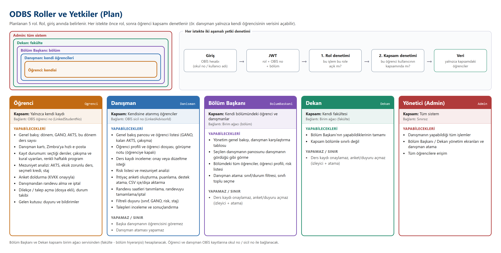
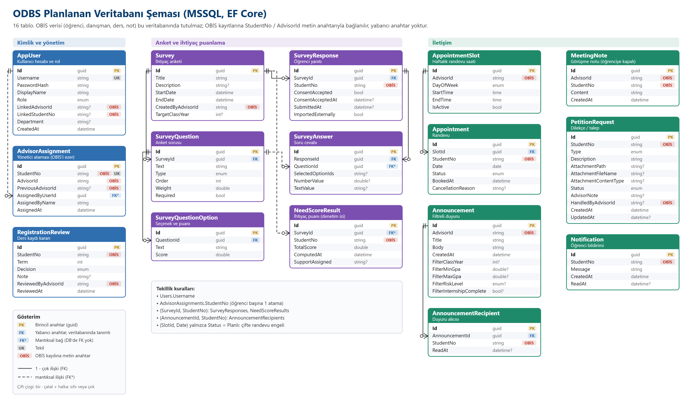

# ODBS (Öğrenci - Danışman Bilgi Sistemi) Proje Planı

Hocam, proje şu an planlama aşamasında; henüz hiçbir şey tamamlanmış değil. Bu raporda istediğiniz başlıklara göre ne yapmak istediğimi, nasıl yapacağımı, mimariyi, rolleri, veri tabanı şemasını, Bilgi İşlem'den isteyeceklerimi, API ve web servis ihtiyaçlarını, birim ağacı entegrasyonunu ve fikirlerimi anlattım.

## 1. Amaç

Danışman hocaların öğrencilerinin ders kayıtlarını, risk durumunu ve mezuniyet ilerlemesini tek ekrandan görebileceği, öğrencinin de danışmanıyla randevu, duyuru ve dilekçe işlerini yürütebileceği bir web uygulaması geliştirmek istiyorum. Sistem öğrenci ve ders verisini OBİS'ten okuyacak.

## 2. Yapmak istediklerim

- **Ders kaydı kontrol ekranı.** Şu an danışman hoca, öğrencilerinin dönem başı ders seçimlerini tek tek elle inceliyor: ders programına bakıp çakışma arıyor, AKTS toplamını hesaplıyor, öğrencinin alttan dersi var mı diye transkripte bakıyor. Bu ekranla o elle yapılan kontrolü otomatikleştirmek ve hocanın zamanını almamak istiyorum. Sistem hiçbir kaydı engellemeyecek, reddetmeyecek, kural koymayacak. Yalnızca bulduğunu hocanın önüne koyacak; ne yapılacağına, uyarıya rağmen onay verilip verilmeyeceğine hoca karar verecek. Örneğin sistem "bu iki ders çakışıyor" diyecek, hoca durumu sorun etmiyorsa kaydı olduğu gibi onaylayacak. Kontrol etmeyi planladıklarım:
  - **Ders programı çakışması:** öğrencinin seçtiği derslerin saatleri üst üste biniyor mu? Biniyorsa çakışan derslerden hangisinin alttan alınan ders olduğunu ve üst sınıf dersinin başka bir şubesi olup olmadığını hocaya göstermek istiyorum. Devam şartı olmayan bir ders varsa çakışma sorun olmayabileceği için ayrıca işaretleyeceğim.
  - **Dönem AKTS toplamı:** öğrencinin seçtiği derslerin toplam AKTS'si ve limite göre durumu. Hoca her öğrenci için elle toplamak zorunda kalmasın.
  - **Alttan ders:** öğrencinin daha önce alıp geçemediği ders bu dönem seçilmiş mi, seçilmemişse hocaya hatırlatmak istiyorum. Hatırlatmayı hoca kendi önceliğine göre değerlendirir.
- **Haftalık program:** öğrencinin derslerini renklerle göstermeyi düşünüyorum: yeşil (çakışma yok), turuncu (devam şartı yok), kırmızı (çakışma), gri (alınmadı).
- **Danışman paneli:** öğrenci listesi (iletişim, GANO, kalan AKTS, çakışma bilgisi), öğrenci profili, ders kaydı onayı veya düzeltme isteği.
- **Erken uyarı ve mezuniyet analizi:** GANO, devamsızlık (%20 uyarı, %30 sınır), eksik zorunlu ders, AKTS, seçmeli kredi ve staj günü takibi.
- **Anket ve ihtiyaç puanlama:** ağırlıklı sorular, KVKK onayı, puana göre destek atama.
- **İletişim araçları:** randevu saatleri, görüşme notları, filtreli duyuru, dilekçe/talep, bildirim.
- **Yönetim katmanı:** Admin, Bölüm Başkanı ve Dekan rolleri. Danışman atama ekranı (sınıf, bölüm, durum filtreleri; bir sınıfı toplu seçme). Her sınıfa tek danışman düzenini öneriyorum; gerekirse yönetici istisna atama yapabilir.
- **Öğrenci ekranı:** dönem, GANO, AKTS ve danışman bilgisi. Danışmana Zimbra üzerinden hızlı e-posta.
- **Sizin isteklerinizi** de ekledim (ayrıntı bölüm 9): danışmanın sicil no'su ile öğrencilerinin listelenmesi; alması gereken dersi almayan öğrencinin danışmana bildirilmesi.

## 3. Yöntem

- **Teknoloji:**
  - **ASP.NET Core (C#, .NET 8):** arka yüz, yani iş mantığı ve API.
  - **MSSQL:** ODBS'nin kendi verisini (randevu, anket, atama, duyuru, talep) saklamak için.
  - **React + TypeScript:** rol bazlı web arayüzü.
- **Katmanlı mimari** (Domain, Application, Infrastructure, Api) kurmak istiyorum. OBİS'e erişimi tek bir arayüzden geçireceğim (`IObisClient`, adapter deseni). Geliştirme sırasında OBİS ile aynı sözleşmeyi taklit eden bir **Mock OBİS servisi** kullanacağım. Gerçek OBİS bağlandığında yalnızca bu arayüzün gerçek uygulamasını yazmam yeterli olacak; ders kaydı kontrolleri, ekranlar ve servisler değişmeyecek.
- **OBİS'e yalnızca okuma yapacağım.** OBİS'te olmayan veriyi (danışman kararı, randevu, anket, atama, duyuru, talep) ODBS'nin kendi veritabanında tutmayı planlıyorum.
- Test verisi için Selçuk Üniversitesi Bilgisayar Mühendisliği'nin Bologna müfredatını ve 2026-2027 güz ders programını kullanacağım. Kişi verileri kurgusal olacak.
- Geliştirmeyi aşama aşama yapacağım; her aşamayı otomatik testlerle doğrulayacağım, her uç nokta için yetki testleri yazacağım.

## 4. Mimari

```
[React/TS/Vite SPA]  --JWT-->  [.NET 8 Web API]  --> [MSSQL: ODBS'nin kendi verisi]
                                       |
                                 IObisClient (adapter)
                                       |
                    +------------------+------------------+
                    |                                     |
         [Mock OBİS (geliştirme)]               [Gerçek OBİS servisleri (hedef)]
```

| Katman | İçerik |
| --- | --- |
| Frontend | React + TypeScript + Vite. Rol bazlı ekranlar: öğrenci, danışman, yönetici |
| Api | Uç noktalar, JWT kimlik doğrulama, rol ve kapsam denetimi (danışman yalnızca kendi öğrencisini görür) |
| Application | Ders kaydı kontrolleri, risk, mezuniyet, anket puanlama, OBİS sözleşmesi (`IObisClient`) |
| Domain | Varlıklar |
| Infrastructure | EF Core + MSSQL, OBİS istemcisi, önbellek |

Güvenlik planım: OBİS hesabıyla giriş (ayrı parola tutmayacağım), JWT, rol bazlı erişim, her uç noktada yetki denetimi, yüklenen dosyaların rastgele adla saklanması, KVKK onayı.

### Roller ve yetkiler

Sistemde 5 rol olmasını planlıyorum: Öğrenci, Danışman, Bölüm Başkanı, Dekan, Yönetici (Admin). Her istekte iki denetim yapmayı planlıyorum. Önce uç noktanın izin verdiği rolü, sonra kullanıcının o öğrenciyi görme kapsamını kontrol edeceğim: öğrenci yalnızca kendini, danışman kendi öğrencilerini, Bölüm Başkanı kendi bölümünü, Dekan fakültesini, Admin herkesi görecek.

| İşlem | Öğrenci | Danışman | Bölüm Başkanı | Dekan | Admin |
| --- | :---: | :---: | :---: | :---: | :---: |
| Kendi genel bakışı, danışman bilgisi, Zimbra e-posta | ✓ | | | | |
| Kendi ders seçimi, kontrol uyarıları, haftalık program | ✓ | | | | |
| Kendi mezuniyet analizi | ✓ | | | | |
| Anket doldurma (KVKK onayı) | ✓ | | | | |
| Randevu alma / iptal | ✓ | iptal | | | iptal |
| Dilekçe / talep açma ve takip | ✓ | | | | |
| Gelen kutusu (duyuru, bildirim) | ✓ | | | | |
| Öğrenci listesi ve profili | | kendi öğrencileri | bölümü | fakültesi | tümü |
| Risk listesi, mezuniyet analizi | | kendi öğrencileri | bölümü | fakültesi | tümü |
| Ders kaydı onay / düzeltme isteği | | ✓ | | | ✓ |
| Öğrenci dosyası, görüşme notu | | ✓ | | | ✓ |
| Anket oluşturma, puanlama, destek atama | | ✓ | | | ✓ |
| Randevu saatleri tanımlama, tamamlama | | ✓ | | | ✓ |
| Filtreli duyuru gönderme | | ✓ | | | ✓ |
| Talepleri sonuçlandırma | | ✓ | | | ✓ |
| Yönetim genel bakışı, danışman karşılaştırma | | | ✓ | ✓ | ✓ |
| Danışmanın panosunu görüntüleme | | | ✓ | ✓ | ✓ |
| Danışman atama | | | bölümü | fakültesi | tümü |

Bölüm Başkanı ve Dekan'ı izleme ve atama rolü olarak düşündüm. Ders kaydı onaylamayacak, anket veya duyuru açmayacak; bunlar danışmanın sorumluluğunda kalacak. Fakülte ve bölüm sınırlarını birim ağacından hesaplamayı planlıyorum (bölüm 8). Rollerin şeması bir sonraki sayfadadır.

<div class="er"></div>

## 5. Veri tabanı şeması

OBİS'teki kişilere yabancı anahtar koymayacağım. Bu kayıtlara metin anahtarla bağlanacağım (`StudentNo`, `AdvisorId`), çünkü o veri başka sistemde.

| Tablo | Amaç | Ana alanlar |
| --- | --- | --- |
| `Users` (AppUser) | Hesap ve rol | Username, Role (Admin / BolumBaskani / Dekan / Danisman / Ogrenci), LinkedAdvisorId, LinkedStudentNo, Department |
| `AdvisorAssignments` | Yönetici atamasının OBİS'teki danışmanı ezmesi | StudentNo, AdvisorId, atayan, tarih |
| `RegistrationReviews` | Danışmanın ders kaydı kararı (onay / düzeltme isteği). Güncellenmez, her karar yeni satır | StudentNo, Term, Decision, Note, ReviewedByAdvisorId |
| `Surveys`, `SurveyQuestions`, `SurveyQuestionOptions` | Anket tanımı | Hedef sınıf, tarih aralığı, soru tipi, ağırlık, seçenek puanı |
| `SurveyResponses`, `SurveyAnswers` | Öğrenci yanıtı | (SurveyId, StudentNo) tekil, ConsentAccepted |
| `NeedScoreResults` | Atama anındaki ihtiyaç puanı (denetim izi) | TotalScore, SupportAssigned |
| `AppointmentSlots`, `Appointments` | Randevu | Gün/saat, durum, iptal nedeni. (SlotId, Date) tekil: çifte rezervasyon engeli |
| `MeetingNotes` | Danışman görüşme notu (öğrenciye kapalı) | AdvisorId, StudentNo, Content |
| `Announcements`, `AnnouncementRecipients` | Filtreli duyuru | Sınıf, GANO aralığı, risk, staj filtresi; ReadAt |
| `PetitionRequests` | Dilekçe / talep | Type, Status, AdvisorNote, ek dosya |
| `Notifications` | Bildirim | StudentNo, Message, ReadAt |

Veritabanında tanımlı yabancı anahtarları anket, randevu ve duyuru tabloları arasında kurmayı düşünüyorum. Diğer bağlar mantıksal olacak ya da OBİS kaydına metin anahtarla kurulacak. Şemanın çizimi bir sonraki sayfadadır. Sizin istekleriniz için ek tablolar da planladım (bölüm 9): `OrgUnits` (birim ağacı), `AdvisorNotifications` (danışmana bildirim).

<div class="er"></div>

## 6. Bilgi İşlem'den alınacaklar ve API ihtiyacı

OBİS'ten şu 10 okuma servisine ihtiyacım olacak:

| # | Servis | Ne istiyorum | Alanlar |
| --- | --- | --- | --- |
| 1 | `GET /students` | Öğrenci listesi | öğrenci no, ad, soyad, sınıf, bölüm, öğretim türü (NÖ/İÖ), durum, GANO, danışman sicil no, e-posta, telefon |
| 2 | `GET /students/{no}` | Tek öğrenci | aynısı |
| 3 | `GET /advisors` | Danışman (öğretim elemanı) listesi | sicil no, ad, soyad, unvan, e-posta |
| 4 | `GET /courses` | Ders kataloğu | kod, ad, AKTS, kredi, dönem (1-8), zorunlu/seçmeli |
| 5 | `GET /schedule?term=` | Ders programı, **tüm şubeler** | ders kodu, şube, gün, saat aralığı, derslik, dönem |
| 6 | `GET /students/{no}/registrations?term=` | Öğrencinin dönem başı ders seçimi | ders kodu, şube, onay durumu, devam şartı |
| 7 | `GET /students/{no}/transcript` | Transkript | dönem, ders, harf notu, geçti/kaldı, kredi, AKTS |
| 8 | `GET /students/{no}/attendance?term=` | Devamsızlık | ders, toplam oturum, katıldığı oturum |
| 9 | `GET /curriculum` | Müfredat şartları | zorunlu ders kodları, toplam AKTS, seçmeli kredi, staj günü |
| 10 | `GET /students/{no}/internship` | Staj | tamamlanan gün |

İstediğiniz danışman → öğrenci sorgusu için ayrıca **`GET /advisors/{sicilNo}/students`** servisini isteyeceğim. Danışmanın sicil numarası gider, danışmanı olduğu öğrenciler döner. Tek çağrılık özel servis olması hem hızlı hem güvenli (her öğrenci için ayrı çağrı gerekmez). Ders önkoşulları ve sınav programını kullanmayacağım için bunları istemeyeceğim.

Bilgi İşlem'e soracaklarım:

- **Erişim yöntemi:** REST mi, SOAP mu, veritabanı görünümü mü? Kimlik doğrulama (API anahtarı, OAuth, mTLS)?
- **Test ortamı:** gerçek veriye dokunmayan bir test OBİS'i ve örnek yanıtlar.
- **Giriş:** kullanıcılar mevcut OBİS hesaplarıyla girecek (öğrenci okul no + OBİS şifresi, öğretim elemanı OBİS kullanıcı adı + şifresi). Bunun için OBİS'in giriş doğrulama servisi (veya SSO/LDAP) ve rolün (öğrenci/öğretim elemanı) kimlikten gelmesi gerekiyor.
- **Devam şartı alanı:** hangi alandan geliyor? Alttan ders OBİS'te ayrı işaretli mi?
- **E-posta adresleri:** OBİS'te var mı, yoksa `adsoyad@selcuk.edu.tr` / `adsoyad@ogr.selcuk.edu.tr` kuralı mı kullanılacak?
- **Çağrı limiti ve KVKK:** veri anlık mı çekilecek, önbelleğe alınabilir mi, saklama sınırları neler?

## 7. Hangi web servislerine ihtiyacım var

1. **OBİS veri servisleri:** yukarıdaki 10 servis + danışman → öğrenci sorgusu (toplam **11 çağrı tipi**).
2. **Birim ağacı web servisi** (bölüm 8).
3. **Kimlik doğrulama servisi (OBİS girişi / SSO / LDAP):** kullanıcılar ayrı hesap açmadan OBİS bilgileriyle girecek. Öğrenci okul no ile, danışman OBİS kullanıcı adıyla girer. Giriş sonrası sistem danışmanın sicil no'sunu bilir ve öğrenci sorgusunda arka planda kullanır; kullanıcı sicil no yazmaz.
4. **E-posta:** uygulama içinden e-posta göndermeyeceğim, kullanıcıyı Zimbra'ya yönlendireceğim. Danışmana otomatik bildirim e-postası istenirse Selçuk SMTP/Zimbra servisi gerekir.

## 8. Birim ağacı web servisini projeye nasıl aktaracağım

Önerim: **ağacı her istekte canlı çağırmak yerine yerel tabloya senkronlamak.**

1. Servisi çağıran bir `IOrgUnitClient` arayüzü yazacağım (OBİS için planladığım adapter deseninin aynısı).
2. Ağacı `OrgUnits` tablosuna alacağım: `Id`, `ParentId`, `Ad`, `Tür` (üniversite / fakülte / bölüm / anabilim dalı), `Kod`. Arka planda günlük veya haftalık bir iş tabloyu yenileyecek. Birim ağacı nadir değiştiği için her istekte servise gitmeyeceğim, servis kesilse de uygulama çalışacak.
3. Ağaç **yetki kapsamını** belirleyecek: Bölüm Başkanı kendi bölümünü, Dekan kendi fakültesindeki tüm bölümleri, Admin hepsini görecek. Kapsamı `ParentId` zincirinden hesaplayacağım.
4. Öğrencinin ve danışmanın bölüm bilgisini serbest metin yerine `OrgUnits.Id`'ye bağlayacağım. Atama ekranındaki bölüm filtresi ve danışman karşılaştırma tablosu ağaçtan beslenecek.
5. Danışmanın sicil no'su ile ağacı eşleştireceğim: hoca hangi bölümde, hangi fakültede.

## 9. Sizin istekleriniz: nasıl yapacağım

| İstek | Planım |
| --- | --- |
| Danışmanın sicil no'su gider, öğrencileri döner | OBİS sözleşmesine `GetStudentsByAdvisorAsync(sicilNo)` ekleyeceğim ve Bilgi İşlem'den tek çağrılık servis olarak isteyeceğim. Giriş yapan danışmanın sicil no'su hesabında tutulacağı için kullanıcı ayrıca yazmayacak |
| Öğrenci alması gereken dersi alamıyor, danışman bunu göremiyor (mezuniyette fark ediliyor) | Danışmanın öğrenci listesine "alması gereken ama almadığı ders" sütunu ekleyeceğim. Kaynak: müfredat − transkript − bu dönem seçimi |
| Öğrenci alması gereken dersi almazsa danışmana bildirim gitsin | `AdvisorNotifications` tablosunu kuracağım: kayıt dönemi kapandığında (veya her ders kaydı değişiminde) alması gereken dersi almamış öğrenci için danışmana bildirim üretilecek. Bildirim tipleri: eksik zorunlu ders, alttan ders alınmadı, başarısız ders yeniden alınmadı. İsteğe bağlı e-posta, Zimbra/SMTP erişimiyle |

## 10. Fikirlerim ve sonraki adımlar

**Fikirlerim:**
- Erken uyarıya göre danışmana haftalık özet (riskli öğrenciler, eksik dersler).
- Aynı derste çok sayıda çakışma varsa bölüm başkanına şube açma önerisi (ders programı planlamasına girdi).
- Anket sonuçlarının .xlsx olarak içe/dışa aktarılması.

**Gerçek OBİS'e geçişte dikkat etmem gerekenler:**
- Eşikleri (AKTS limiti, müfredat, staj günü, devamsızlık sınırı) üniversite yönetmeliğine göre ayarlayacağım.
- Binlerce öğrencide toplu servis çağrısı veya gece çalışan ön hesaplama işi gerekebilir.
- "Devam şartı" bilgisinin OBİS'teki kaynağını Bilgi İşlem'le netleştireceğim.
- Danışman e-postası OBİS'te yoksa ad-soyaddan türetmem gerekecek; bu gerçek adresle uyuşmayabilir.
- Yüklenen dosyalarda virüs taraması yapılmalı, KVKK metni hukuk birimiyle netleştirilmeli.
